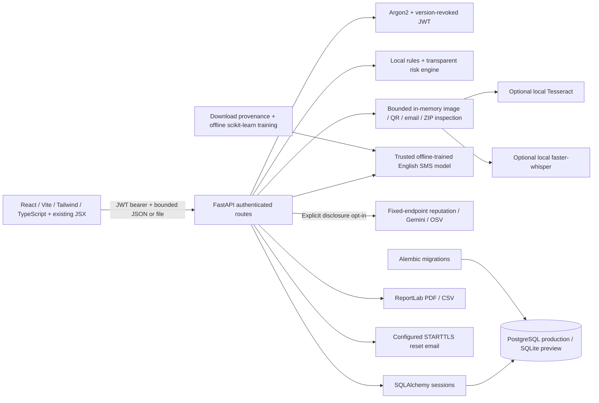
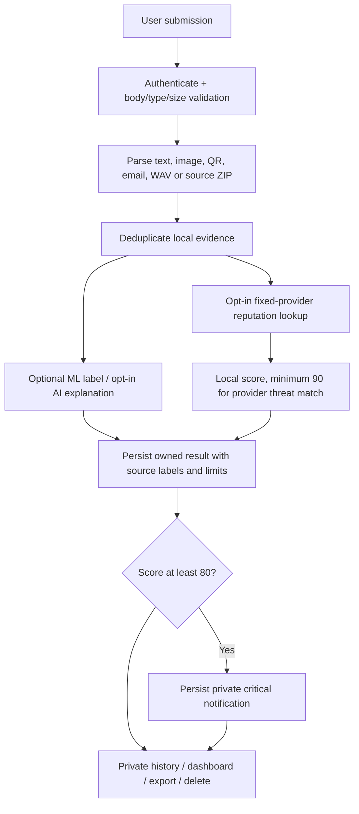

# System architecture and workflows

## Data and trust boundaries
`users` owns `scans`, `reports`, `reset_tokens`, `notifications`, and `quiz_attempts` via indexed foreign keys. Scan results and indicators are stored as JSON. `security_api_logs` stores only provider/status/timestamp; it does not store keys, messages or submitted URLs. A second migration adds notifications, quiz attempts and provider logs.

JWTs are stored in sessionStorage, expire by default after 30 minutes, and are invalidated across sessions by logout/password changes. This avoids ambient-cookie CSRF but JavaScript-accessible tokens remain vulnerable to XSS; evaluate a hardened cookie/session design before production. React renders untrusted output as text, not HTML.

No submitted website is fetched. Reputation lookup endpoints are fixed. GitHub retrieval accepts only a strict github.com owner/repo URL, queries fixed API endpoints, pins an immutable commit and bounds the codeload archive. No git command, repository hook or source code is executed.

Uploads are body-bounded before multipart parsing, then validated by their processing pipeline. Images have MIME/content/pixel checks. ZIPs are inspected in memory without extraction, reject traversal/symlinks/encryption and enforce expansion/file-count caps. Code findings omit matched lines to avoid disclosing secrets. Original uploads are discarded; text and findings remain until scan deletion. Optional Whisper uses a temporary WAV deleted after processing.

OCR/voice processing currently uses bounded inputs and a thread, not a separate OS sandbox/queue. Deploy dedicated resource-limited workers before accepting unrestricted public workloads. The application does not run external Semgrep/Bandit/Gitleaks tools or arbitrary user code.

External checks require per-request consent; external services' retention/terms still apply. Rule-based risk, provider evidence, ML spam labels and AI explanations are displayed separately. Only real provider matches establish the 90-point score floor; neither AI prose nor ML labels are treated as independently verified fraud evidence.
